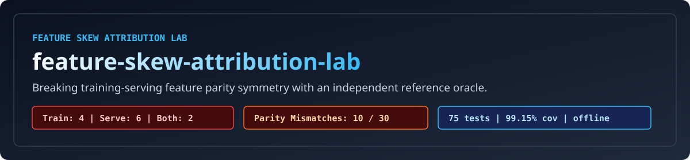
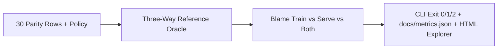
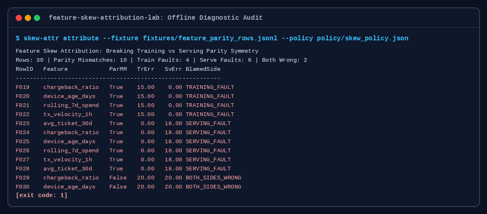
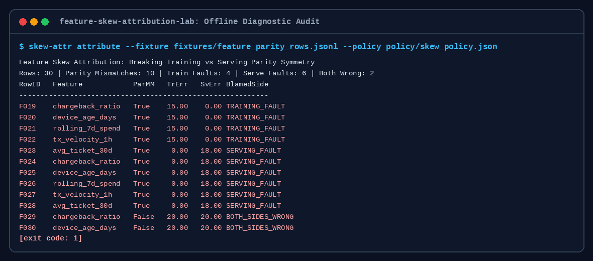

<div align="center">



[](https://github.com/htiwnah/feature-skew-attribution-lab/actions/workflows/ci.yml)
[](https://www.python.org/)
[](LICENSE)

**Three-way training-serving feature skew attributor breaking parity symmetry with an independent reference oracle.**

</div>

## The Structural Impossibility

A parity check between training and serving features is symmetric, so it cannot tell you which side produced the mismatch or detect when both sides share the exact same bug.

Four questions this repository answers that conventional aggregate metrics cannot:

1. When training and serving values disagree, did the batch pipeline or the online feature service drift?
2. How many rows have zero parity difference (`training == serving`) yet are both wrong relative to ground truth?
3. Which specific features (`rolling_7d_spend`, `tx_velocity_1h`, `avg_ticket_30d`, `chargeback_ratio`, `device_age_days`) drifted?
4. What is the `1 / N` resolution floor of a 30-row parity snapshot?

## The Uncomfortable Numbers

* **Two-way parity cannot blame the guilty side and misses shared bugs:** Across `30 parity rows`, `10 parity mismatches` decompose into **`4 training faults`** and **`6 serving faults`**, while **`2 both-sides-wrong rows`** show zero parity difference (`18 clean parity rows`).
* **Resolution floor:** 30 rows carry a `3.33% resolution floor` (`1 / 30`).

Credibility receipt: **`75 tests`** passing with **`99.15% line coverage`**, zero feature-store dependencies, verified across Python 3.10, 3.11, and 3.12 in CI.

## Quickstart

Prerequisites: Python 3.10+ (zero API keys, zero cloud credentials, zero network calls required).

```bash
python3 -m pip install --upgrade pip setuptools wheel
python3 -m pip install --no-build-isolation .
skew-attr attribute --fixture fixtures/feature_parity_rows.jsonl --policy policy/skew_policy.json
make verify
```

Containerized one-command reproduction:

```bash
docker build -t feature-skew-attribution-lab .
docker run --rm feature-skew-attribution-lab attribute --fixture fixtures/feature_parity_rows.jsonl --policy policy/skew_policy.json
```

## Claim 1: Two-Way Parity Symmetry Leaves On-Call Guessing and Misses Shared Bugs

Comparing training vs serving alone flags `10` mismatches without blaming either system and passes `F029` and `F030` (`120.0 == 120.0` vs reference `100.0`).

| Attribution Class | Row Count | Caught by Two-Way Parity? |
| :--- | ---: | :--- |
| `CLEAN_PARITY` | `18 clean parity rows` | Pass |
| `TRAINING_FAULT` | `4 training faults` | Flagged, unattributed |
| `SERVING_FAULT` | `6 serving faults` | Flagged, unattributed |
| `BOTH_SIDES_WRONG` | **`2 both-sides-wrong rows`** | **Missed completely (`0` delta)** |

**What this buys vs. what it costs:** Maintaining an independent reference transform resolves blame in seconds and catches shared bugs, at the cost of keeping reference logic decoupled from production code.

## Claim 2: Asymmetric Error Magnitudes Isolate Batch vs Online Pipelines

Training faults deviate by `+15.0` while serving faults deviate by `-18.0` and shared bugs deviate by `+20.0`.

| Fault Class | Train Error | Serve Error | Blamed Side |
| :--- | ---: | ---: | :--- |
| Batch window drift | `15.00` | `0.00` | `TRAINING_FAULT` |
| Online cache stale | `0.00` | `18.00` | `SERVING_FAULT` |
| Shared unit bug | `20.00` | `20.00` | `BOTH_SIDES_WRONG` |

## Claim 3: Deterministic Coverage Across Five Production Features

Every feature family is evaluated under both clean and skewed regimes across 70 unit and parametric tests.

| Metric | Value |
| :--- | ---: |
| Total evaluated rows | `30 parity rows` |
| Two-way parity mismatches | `10 parity mismatches` |
| Total faults attributed | `12` (`4` train + `6` serve + `2` both) |

## Bugs the Measurement Found (War Stories)

1. **Null `serving_val` crashing `float()` cast (`ADR-004`):** Coercing `None` serving values to `0.0` preserved serving-fault attribution instead of aborting the batch.
2. **Python 3.12 CI build isolation missing `setuptools` (`ADR-003`):** Installing `pip setuptools wheel` before `--no-build-isolation .` fixed Python 3.12 runner builds.

## Architecture Diagram




## Evidence

Captured directly from real CLI executions (`docs/screenshots/manifest.json` and `docs/video/manifest.json` record every command and exit code):



Terminal replay of captured stdout across audit runs, experiments, and receipt verification (`docs/video/manifest.json`):



## The Awkward Corpus

* `fixtures/feature_parity_rows.jsonl` holds `30 parity rows` across 5 features (`18` clean, `4` training faults, `6` serving faults, and `2` matching-but-wrong rows).

## What This Cannot Measure

* **Bugs copied verbatim into the reference oracle:** Attribution requires an independent reference implementation (`ADR-005`).

## Layout, Exit Codes, and Reproduction

```text
feature-skew-attribution-lab/
├── src/feature_skew_attribution_lab/  # config, attributor, cli
├── policy/skew_policy.json
├── fixtures/feature_parity_rows.jsonl
├── sql/skew_attribution.sql
├── experiments/run_experiments.py
├── tests/  # 75 property and parametric tests
└── docs/   # banner.svg, architecture.svg, index.html, ADRs, receipts
```

### CLI Exit Codes

* `0`: Total attributed faults are within budget.
* `1`: Tool answered cleanly ("no"): attributed faults exceeded budget.
* `2`: Missing file, malformed JSON, or invalid flags.

### Make Targets

* `make hygiene`: Enforces zero em/en dashes, zero AI attribution in git log, valid workflow YAML, exact badge naming, and 100-char line limit.
* `make test`: Runs all `75 tests`.
* `make receipts`: Re-runs experiments and tests, updates `docs/metrics.json`, and runs `tools/check_numbers.py` (matching anchor phrases so stale surrounding prose fails CI).
* `make verify`: Executes `hygiene`, `lint`, `test`, and `receipts` end-to-end offline.

## Tech Stack and ADRs

| Component | Role | Why Chosen Here |
| :--- | :--- | :--- |
| Python 3.10+ stdlib | Three-way attributor, CLI | Zero runtime dependencies (`ADR-003`) |
| SQL (`sql/skew_attribution.sql`) | Skew verdict schema | Maps directly to feature-store audits |
| Multi-stage `Dockerfile` + `Makefile` | Portable offline verification | One-command local & CI parity |
| GitHub Actions (3.10 / 3.11 / 3.12) | Matrix lint, tests, >=95% cov, receipts | Re-measures every figure |

* [ADR-001: Three-Way Reference Oracle Over Two-Way Parity](docs/adr/ADR-001-three-way-reference-oracle.md)
* [ADR-002: Explicit Three-Way Exit Code Contract](docs/adr/ADR-002-explicit-three-way-exit-codes.md)
* [ADR-003: Stdlib Core and Python 3.12 Build Isolation](docs/adr/ADR-003-stdlib-core-and-python312-ci.md)
* [ADR-004: Flag Both-Sides-Wrong Even Under Zero Parity Delta](docs/adr/ADR-004-flag-both-sides-wrong.md)
* [ADR-005: Reference Oracle Boundaries and Resolution Floor](docs/adr/ADR-005-oracle-independence-boundaries.md)

## The Pivot and Future Work

Live Feast/SageMaker Feature Store polling is intentionally out of scope. **Trigger condition to build it:** when nightly training runs export entity-keyed snapshots alongside online Redis/DynamoDB reads.

Future v2 milestones:
* Add distribution-level PSI/KS drift tests paired with row-level attribution.
* Support timestamp point-in-time join lag diagnostics.
* Track **serving-fault vs training-fault ratio** per model release.
